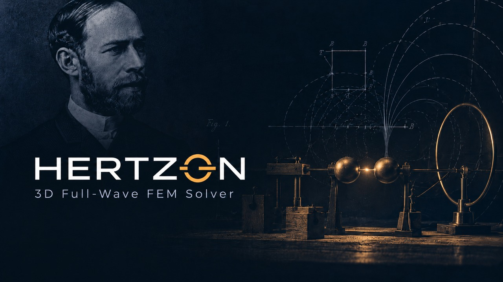

# Hertzon



> ⚠️ **Hertzon is under active development. It can still contain bugs, which are being fixed step by step.
> Please verify important results independently and report problems as GitHub issues.**

An open-source 3D full-wave electromagnetic simulator with a **classic engineering workflow**:
draw the model, assign boundaries and excitations, add an analysis setup with
**adaptive meshing**, add frequency sweeps, analyze, then look at S-parameters, fields
and radiation patterns. The finite-element solver underneath is
[EMerge](https://github.com/FennisRobert/EMerge) (2nd-order Nédélec FEM, gmsh/OpenCASCADE geometry).

Hertzon is a desktop application (Qt + VTK) built for responsiveness with large models:
geometry is tessellated incrementally per object, the solver runs in its own process, and
results are streamed back into the GUI while it keeps working.

> Hertzon is an independent open-source project. It is not affiliated with any vendor of commercial
> simulation software.

## Install

Download the installers from the [Releases page](https://github.com/c8501024/Hertzon/releases/latest).

**Windows installer:** run **`Hertzon-Setup-<version>.exe`**. It installs Hertzon for your user
(no administrator rights) into `%LOCALAPPDATA%\Programs\Hertzon`, adds it to the start menu, the
desktop and Settings > Apps (uninstall there), opens `.hzn` projects with Hertzon and sets up the
Python environment (about 1 GB download) before it finishes.

**Linux:** unpack `Hertzon-<version>-linux.tar.gz` and run `./install.sh`. It installs for your user
into `~/.local/share/hertzon`, adds Hertzon to the application menu, the command `hertzon` and the
`.hzn` file type. Run `install.sh` of a newer package to update, `~/.local/share/hertzon/uninstall.sh`
to remove it.

Both are built with `packaging/build_installer.sh` (needs NSIS for the Windows installer); GitHub Actions
builds them and publishes a release for every version (`.github/workflows/release.yml`).

**Windows, without installing:** unzip and double-click **`Hertzon.exe`**. On the first start it installs
everything it needs into a `.venv` folder next to it (Python 3.13 via winget if missing, then
EMerge, Qt and VTK, about 1 GB) and compiles the solver with a small test solve, then opens
Hertzon. Later starts open Hertzon directly, and the first simulation runs at full speed.
You can drag a `.hzn` file onto `Hertzon.exe` to open it. To reinstall, delete `.venv`.

**Manually (any OS),** Python 3.10 or newer:

```bash
python -m venv .venv && source .venv/bin/activate      # Windows: .\setup.ps1 then .\run.ps1
pip install -e .                                        # installs emerge, PySide6, pyvista, pyvistaqt ...
python -m hertzon examples/WaveguidePost.hzn             # or just: hertzon
```

The first solve compiles EMerge's numba kernels, which takes a few minutes once; later solves start
immediately. On Linux without a desktop, run under `xvfb-run`.

## The workflow

1. **Project > Insert Design**, then **Simulation > Solution Type**: Modal, Terminal or Eigenmode,
   with **Auto Open** (radiation or PML chosen automatically) or **Auto Open - Filter**
   (air box with fixed margin and a radiation boundary, for filters and other closed-ish circuits).
2. **Draw** boxes, cylinders, spheres, cones, tori, polyhedra, rectangles, circles, ellipses,
   polygons, polylines, region. Click on the grid (snaps to grid and vertices) or type coordinates
   in the status bar; every parameter accepts expressions with **variables** and units.
   **Modeler > Boolean** unite / subtract / intersect / split, arrange, duplicate, thicken, sweep, import STEP.
3. Select faces (**F**) or objects (**O**) and assign **Boundaries** (Perfect E/H, Finite
   Conductivity, Impedance, Lumped RLC, Radiation, PML, Symmetry) and **Excitations** (Wave Port,
   Lumped Port, Floquet Port).
4. **Analysis > Add Solution Setup**: solution frequency (single / multi / broadband), maximum
   passes, maximum Delta S, matrix convergence, minimum (converged) passes, percent refinement,
   maximum refinement, lambda refinement, solver choice. **Add Frequency Sweep**: discrete or
   interpolating, linear step / count / log / single points.
5. **Validation Check**, then **Analyze All** (F5). The progress window shows each adaptive pass;
   **Solution Data** shows the convergence table and plot, matrix data and mesh statistics.
6. **Results**: rectangular plots, Smith chart, data table, radiation pattern, 3D polar plot;
   **Fields**: magnitude, complex magnitude and vector plots of E, H and surface current on faces,
   objects or cut planes, with phase animation. Export Touchstone, CSV, images.

See [docs/FEATURE_MATRIX.md](docs/FEATURE_MATRIX.md) for an overview of what is implemented and
what is still missing.

See [docs/MESHER.md](docs/MESHER.md) for how the adaptive mesh refinement works: hzmesh, the local
Delaunay mesher, curved elements and benchmark results.

## Examples

| File | What it shows |
|---|---|
| `examples/WaveguidePost.hzn` | WR-90 waveguide with an inductive post, wave ports, interpolating sweep 8-12 GHz |
| `examples/Microstrip.hzn` | 50 Ω microstrip on FR4, lumped ports, thin-conductor trace, **Auto Open - Filter** |
| `examples/PatchAntenna.hzn` | 2.45 GHz inset-fed patch, **Auto Open** (PML), far field, gain pattern |

Regenerate them with `python examples/make_examples.py`.

## Scripting

* **File > Export EMerge Python Script** writes a stand-alone script that rebuilds the same EMerge
  model (geometry, materials, boundaries, ports, initial mesh) and runs the setup, or stops after
  meshing with `--prepare-only` so you can continue in plain EMerge.
* Solve without the GUI: `python -m hertzon.solver.run Project.hzn DesignName Setup1 out_folder`.
* Project files (`.hzn`) are plain JSON; results go to `<project>.hznresults/<design>/<setup>/`
  (`sparams_*.npz`, Touchstone `*.sNp`, `fields_*.npz`, `farfield_*.npz`, `convergence.json`).

## AI assistants (MCP)

Hertzon ships an MCP server, so Claude Code, Codex or VS Code (Copilot agent mode) can build and run
simulations: "build a 2.45 GHz patch on FR4 with a lumped port, solve it and give me S11 and the gain".

1. **Tools > AI Assistants (MCP)...**: press *Register* next to your assistant (Claude Code gets an
   entry in `~/.claude.json`, the Claude desktop app in `claude_desktop_config.json`, Codex in
   `~/.codex/config.toml`, VS Code in its user `mcp.json`).
   Without the GUI: `python -m hertzon.mcp --install claude` (or `desktop`, `codex`, `vscode`, `all`);
   `python -m hertzon.mcp --config` prints the settings for other clients.
2. Tick **Let AI assistants work in this window**. This also registers Hertzon with every installed
   Claude Code, Claude desktop app and Codex that does not list it yet. Changes then appear in the open window at once
   (Ctrl+Z undoes them) and analyses run in its solve queue. Without the live link the assistant works
   on the `.hzn` files and runs the solver in the background.
3. Start a new session of the assistant and ask for a simulation.

The server offers tools to create projects, set variables and design settings, draw and import
geometry, list faces (index, centre, normal), assign boundaries, ports and mesh operations, define
setups, sweeps and far-field spheres, validate, run, follow the adaptive passes, read S-parameters,
gain or RCS, and render a picture of the model.

## Layout

The Python package keeps its short name `hertzon`, and projects keep the `.hzn` extension.

```
hertzon/model    data model, expressions with units, materials, property schema, validation
hertzon/kernel   OpenCASCADE (gmsh) geometry builder and display tessellation
hertzon/solver   EMerge bridge: auto open, boundary mapping, adaptive passes, sweeps, far field
hertzon/gui      main window, 3D modeler, project tree, property grids, reports, field overlays
hertzon/mcp      MCP server for AI assistants, live link to the window, client registration
```

## Tests

```bash
pip install pytest && python -m pytest tests
```

## Citing Hertzon

If you use Hertzon in a publication, please cite it. GitHub shows a ready-made reference under
**Cite this repository** on the repository page (from `CITATION.cff`), as APA or BibTeX. Please also cite
[EMerge](https://github.com/FennisRobert/EMerge), the solver Hertzon is built on.

## License

GPL-2.0-or-later, the same as EMerge, which Hertzon links against.
All Python packages Hertzon uses and their licences are listed in [docs/THIRD_PARTY.md](docs/THIRD_PARTY.md).
