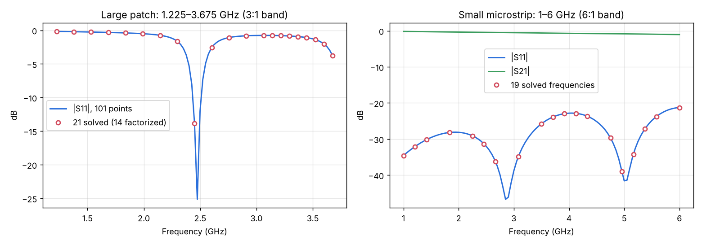

# Benchmarks

Timings of **Tools > Solver Benchmark** on a workstation. Every core count solves the whole setup in a fresh
solver process: initial mesh, adaptive passes and a 101-point interpolating frequency sweep. The projects are
in [`examples/benchmark/scaling`](../examples/benchmark/scaling). Run the same benchmark on your own computer
to find the best number of cores and sweep processes for it.

## Computer

| | |
|---|---|
| CPU | AMD Zen 2 (reported as "AMD64 Family 23 Model 49"), 32 cores, 64 threads |
| Memory | 256 GB |
| System | Windows 10, Python 3.13 |

Measured on 18 and 19 October 2026, shortly before the rename to Hertzon.

## Broadband sweeps

Both cases sweep a wide band, not a few frequencies around one point: the patch antenna from 1.225 to
3.675 GHz (3:1, half to one and a half times its 2.45 GHz resonance), the microstrip from 1 to 6 GHz (6:1).
Each sweep has 101 points. The interpolating sweep solves only some of them (circles) and fits a rational
model through them, adding frequencies until the model changes by less than the tolerance between steps.
For the patch, 7 of its 21 solved frequencies come from the reduced basis of the earlier solutions instead
of a new factorization, so 14 factorizations cover the whole 3:1 band.

*Results of the 64-core runs. Line: the 101 sweep points. Circles: the frequencies that were solved.*

## Large patch (examples/benchmark/scaling/large_patch.hzn)

2.45 GHz patch antenna, radiation boundary, second-order elements. 10 adaptive passes up to 66.9k
tetrahedra (612,762 unknowns, 6.4 GB per factorization, 15 GB peak memory), then the 1.225–3.675 GHz sweep.

| Cores | Total | Adaptive passes | Sweep | Speedup |
|---|---|---|---|---|
| 1 | 1375 s | 315 s | 1043 s | 1.0 |
| 2 | 777 s | 173 s | 601 s | 1.8 |
| 4 | 475 s | 103 s | 368 s | 2.9 |
| 8 | 303 s | 68 s | 231 s | 4.5 |
| 16 | 230 s | 51 s | 174 s | 6.0 |
| 32 | 207 s | 48 s | 155 s | 6.6 |
| 64 | 203 s | 44 s | 154 s | 6.8 |

Sweep with parallel processes (64 cores shared): 1 process 155 s, **2 processes 122 s**, 4 processes
136 s, 8 processes 159 s.

## Small microstrip (examples/benchmark/scaling/small_microstrip.hzn)

50 Ω microstrip with two lumped ports. 4 adaptive passes up to 11.6k tetrahedra (2 GB peak memory),
then the 1–6 GHz sweep with 19 solved frequencies.

| Cores | Total | Adaptive passes | Sweep | Speedup |
|---|---|---|---|---|
| 1 | 78 s | 20 s | 54 s | 1.0 |
| 2 | 53 s | 16 s | 33 s | 1.5 |
| 4 | 39 s | 14 s | 21 s | 2.0 |
| 8 | 32 s | 13 s | 15 s | 2.4 |
| 16 | 30 s | 13 s | 13 s | 2.6 |
| 32 | 29 s | 12 s | 13 s | 2.7 |
| 64 | 29 s | 12 s | 13 s | 2.7 |

Sweep with parallel processes: 1 process 15 s, 4 or more processes 11 s.

## What this means

* The sweep is about three quarters of the time of the large model. Its cost is the number of
  factorizations, not the number of sweep points.
* The large model scales well up to 8–16 cores. Above 16 cores the gain is small, most likely because the
  sparse factorization is limited by memory bandwidth rather than by the number of cores.
* A small model is done in about 30 s from 8 cores on; more cores barely help.
* On a many-core computer, 2 parallel sweep processes saved another 20 % of the sweep of the large model.
* The **Fast** sweep factorizes once at the band centre (a few times for very wide bands) and could cut
  the sweep further; it was not part of this benchmark.
