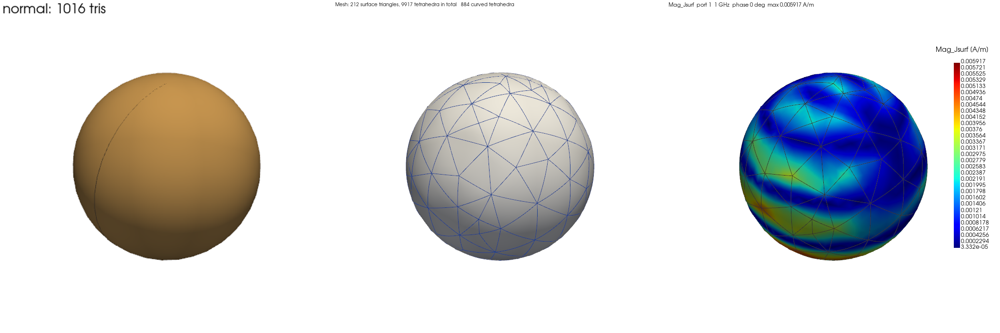

# Adaptive mesh refinement

Every adaptive pass solves the model, rates the error of each tetrahedron with EMerge's error estimate,
refines the mesh where the error is largest and solves again, until Delta S (or Delta E for incident
waves) meets the convergence criterion. Since EMerge 3 and Hertzon's move to EMerge `e03a085`, the
default refinement is **hzAURA**, EMerge's own local refinement. Hertzon's own local Delaunay mesher
**hzmesh** and a gmsh re-mesh stay selectable. Curved elements on curved surfaces are EMerge's as well
(FennisRobert/EMerge#77); Hertzon switches them on with a setup option.

hzmesh refines the tetrahedral mesh of a model **locally**: every node and every element outside the
region the error estimate marks stays exactly as it is, and new nodes appear only where the field needs
them. EMerge solves on the result as usual.

- Core: C++17 with a C interface, `hertzon/mesher/src/hzmesh.cpp` and `hzmesh.h`, built into
  `hertzon/mesher/_bin/` (`libhzmesh.so` for Linux, `hzmesh.dll` for Windows).
- Python side: `hertzon/mesher/core.py` (ctypes binding, gmsh in/out), `hertzon/mesher/adapt.py`
  (size field, growth control, one adaptive pass) and `hertzon/mesher/replay.py` (repeat a pass
  offline).
- Integration: `hertzon/solver/bridge.py` (adaptive passes, refinement methods, fallback),
  `hertzon/solver/curvilinear.py` (curved geometry for the field plots).

## Contents

- [Refinement methods](#refinement-methods)
- [Why local Delaunay refinement](#why-local-delaunay-refinement)
- [Algorithm](#algorithm)
- [Robustness](#robustness)
- [Curved elements](#curved-elements)
- [Chord rule (off by default)](#chord-rule-off-by-default)
- [Threading and parallelism](#threading-and-parallelism)
- [Results](#results)
- [Usage and settings](#usage-and-settings)
- [Building](#building)
- [C interface](#c-interface)
- [Known limitations](#known-limitations)

## Refinement methods

Setup > Advanced > **Mesh refinement** (`RefinementMethod`):

| Method | What it does | Meshes nested? |
|---|---|---|
| Local (Delaunay) | hzmesh refines the current mesh around the worst elements | yes, old nodes never move |
| Remesh (slow) | gmsh meshes the whole model again with EMerge's size field | no |
| Remesh (stable, experimental) | gmsh re-meshes, but the size field holds every current node's size and only shrinks it at the worst elements | nearly |
| **hzAURA (EMerge)** (default, formerly "AURA (EMerge)") | EMerge's local refinement: longest-edge bisection of the worst elements, then flips and smoothing | yes, old nodes never move |

AURA is the default for new setups since it reached the convergence criterion faster, or was more
accurate per tetrahedron, than hzmesh on the benchmark models: a comparison of Local (Delaunay) and AURA
is in [examples/benchmark/mesher](../examples/benchmark/mesher/README.md). Saved setups keep their method.
All methods use the same error estimate (EMerge's), the same marking and the same convergence criterion;
only the refinement step between two passes differs. If a refinement method is not available or a pass
fails, Hertzon re-meshes that pass with gmsh and writes a warning to the log. Older project values
(`Local (Delaunay, experimental)`, `Zone (experimental)`, `Remesh`) are mapped to the current names on
load (`hertzon/model/schema.py`).

The rest of this page describes hzmesh, the curved elements and the measurements made with them.

## Why local Delaunay refinement

A complete re-mesh in every pass makes Delta S compare two unrelated meshes. From about pass 7 on,
this re-meshing noise is as large as the convergence threshold and Delta S jumps. Local refinement avoids that:
it refines in place and nested, so Delta S only measures real progress. Two things are needed at
the same time:

1. Outside the error zone the mesh stays **exactly** the same (otherwise noise in Delta S).
2. Inside the zone the mesh is not only split but meshed **well**, including surfaces.

Of the approaches tried for hzmesh, none did both (patch antenna, second order):

| Approach | Nested? | Quality | Outcome |
|---|---|---|---|
| Remesh (gmsh, from scratch) | no | good | Delta S jumps in late passes |
| Bisection (newest vertex) | yes | gets worse, bad elements are inherited | smooth, but too many tets |
| Bisection + gmsh optimiser | almost | volume fine, surfaces not repaired | Delta S 0.006 at 22k tets |
| Mmg, global | no | good | noisy, slow |
| Mmg zone re-mesh (frozen outside) | yes | good | dropped, fell back to re-mesh |
| TetGen `-r -q` | no, only about 20 % of the old nodes stay | good | growth not controllable (x4-5 per pass), AGPL |
| gmsh Delaunay with fixed old nodes | yes | collapses (5 % quality 0.53 -> 0.01) | unusable |

Bisection keeps the mesh nested and conforming, but flat start tets stay flat (exactly what a thin
patch substrate is made of), and halving can never improve quality. Delaunay insertion with a
cavity (Bowyer-Watson) also keeps every old node, so it is nested too. It reconnects the
neighbourhood of each new point, though, so bad elements are repaired while refining instead of
inherited.

## Algorithm

One adaptive pass (`adapt.refine_model`):

1. **Input from gmsh**
   - nodes with their classification (point, curve, surface or volume, plus the entity tag);
   - tets with their volume tag (material);
   - boundary triangles with their surface tag (ports, PEC, boundaries) and curve segments.
2. **Size field** (`adapt.py`)
   - Current size h per node: mean of EMerge's element sizes of the surrounding tets.
   - The nodes of the k worst tets get the target 0.7 h.
   - The field is graded towards the rest of the mesh with the growth rate (Dijkstra in C++,
     `hzm_grade`).
   - Zone = nodes whose target is below their current size. Outside the zone **nothing** changes.
3. **Refine**, in the order curve segments -> boundary triangles -> tets
   - Size: if the **longest edge** is longer than h, its midpoint is inserted (on the curve,
     surface or in the volume the edge belongs to).
   - Shape: elements with a bad circumradius-to-edge ratio (tet > 2, triangle > 1.3) get their
     circumcentre, but only inside the zone.
   - Insertion uses a Bowyer-Watson cavity that is bounded by CAD surfaces and curves
     (constrained Delaunay), so no material or port boundary is ever cut.
   - A boundary triangle or segment that the new point encroaches on is split first.
   - New points on curved CAD surfaces and curves (sphere, cylinder, spline) are projected onto
     the real geometry with `gmsh.model.getClosestPoint`.
4. **Improve**, new elements only: 2-3 and 3-2 flips, edge removal (optimal triangulation of 3
   to 7 tets around an edge) and smoothing of the new nodes (surface nodes stay on their surface).
   Old nodes never move.
5. **Growth control**: k is chosen so that the mesh grows by the refinement percentage (0.8 to
   1.25 times the target). A trial on a copy (`hzm_clone`) costs milliseconds; at most 6 trials.
6. **Back to EMerge**: the mesh is written into the gmsh model (old node tags are kept), then the
   normal EMerge import runs. Ports, materials and far field therefore work unchanged.

AURA works differently: EMerge bisects the marked tetrahedra along their longest edge and improves the new
elements with flips and smoothing, inside EMerge's own mesh, without a gmsh run per pass. Its meshes are
nested as well.

New nodes on curved faces and edges are moved from the chord onto the CAD geometry. Where the elements
around the split edge are too thin for that move, Hertzon runs AURA with EMerge's cavity option (hzAURA):
the node is put on the surface anyway, and the elements around it are cut out and re-meshed as a
constrained Delaunay cavity, the same idea as a point insertion of hzmesh. Nodes and elements outside the
cavity stay as they are. Plain bisection would leave such a node closer to the chord, a dent in the
refined surface. Faces that are not spheres, cylinders or planes are followed by a bicubic interpolation
of their CAD parametrisation.

## Robustness

- Shewchuk's exact predicates (`orient3d`, `insphere`, `predicates.c`), compiled with
  `-ffp-contract=off`. The Linux library and the Windows DLL produce bit-identical meshes.
- Every cavity is checked before it replaces the old elements: closed hull, no face used twice, no
  holes, all boundary faces tagged, and volume preserved for flat entities. If a check fails, the
  point is dropped and the mesh stays valid.
- A cavity must not swallow a free curve (edge of a sheet, embedded curve) or a boundary triangle
  that is not being re-triangulated. Such triangles are split together with the cavity, otherwise
  the point is dropped.
- After every pass `hzm_check` verifies the whole topology. On a problem or an exception Hertzon falls
  back to a gmsh re-mesh for that pass and logs a warning.
- Stress tests on box, sphere, cylinder, coax and patch over many passes
  (`hertzon/mesher/src/test/t_stress.py`): always valid, old nodes unmoved, volumes and surfaces
  preserved.
- `HZMESH_DUMP=<folder>` saves the input of every pass; `python -m hertzon.mesher.replay FILE`
  repeats a failed refinement offline.

## Curved elements

EMerge used to treat every tet as affine, with straight edges and flat faces. A round post, rod or
resonator then becomes a polygon. For strongly reflecting curved objects this faceting error dominates
the S-parameters, and the error estimate cannot see it, because it rates the field on the mesh and
not the mesh's distance from the geometry.



Tets on curved surfaces therefore get quadratic edges (isoparametric, 10 nodes). Since
FennisRobert/EMerge#77 this is part of EMerge (`Settings.mw_curved_elements`), and Hertzon uses EMerge's
version instead of its own former kernels, with the same results and meshes on the benchmark models (see
[EMERGE_INTEGRATION.md](EMERGE_INTEGRATION.md)). The method:

- The midpoint of every mesh edge on a curved CAD surface or curve is moved onto the real geometry
  (displacement d_e).
- Mapping: x = y + sum d_e phi_e(y) with phi_e = 4 lambda_i lambda_j on the straight tet y,
  Jacobian D = I + sum d_e (x) grad phi_e.
- The covariant Piola transform can be written as a straight tet with a pointwise material:
  - curl term: mu^-1 -> D^T mu^-1 D / det D
  - mass term: eps -> det D D^-1 eps D^-T
- The basis functions therefore stay unchanged; only the element matrices of the curved tets differ.
- Conforming: a face without a curved edge stays exactly flat and keeps its tangential trace. Every
  tet that contains a curved edge is curved itself and uses the same displacement for that edge.
- Curved are PEC, metal (finite conductivity), symmetry and material faces. Straight stay faces with
  their own surface integrals: ports, absorbers, impedance and RLC boundaries, thin conductors and
  periodic boundaries. A curved face that touches a port stays straight too, otherwise the straight port
  mode would see a curved line behind it, i.e. an impedance step (coax, circular waveguide).
- Hertzon uses the same curved map (`hertzon/solver/curvilinear.py`) to draw the mesh and to map the
  fields of the curved tets in the field plots.
- Setting: Setup > Options > **Curved elements on curved surfaces** (default on).

## Chord rule (off by default)

Before curved elements existed, hzmesh split edges on curved surfaces whose chord deviated too far
from the geometry (parameter `sag`, fraction of the target size). With curved elements this only
costs tets, so `sag` is 0 by default. `HZMESH_SAG=0.02` turns it on for experiments. It measures
the deviation relative to the end points and stops at edges below 2 % of the target size, so a node
that had to be inserted next to the surface cannot trigger endless splitting.

## Threading and parallelism

hzmesh currently runs **serially** on one core:

- The C++ core starts no threads and uses no OpenMP; the `thread_local` buffers in `hzmesh.cpp`
  are reused scratch memory, not parallelism. The build scripts use neither `-fopenmp` nor
  `-pthread`.
- Python calls the core once per pass, and the up to 6 growth-control trials run one after another,
  each on its own copy.
- Only the solver runs in parallel (EMerge, PARDISO).

At 570k tets the core needs 0.15-0.3 s per pass, less than 1 % of the solve time, so parallelising
has not paid off yet. If it ever does, there are two deterministic options:

- Insert the points of a sweep in groups whose cavities do not touch (graph colouring on the
  cavity tets).
- Split the zone into spatially separate clusters, one thread each, with locked cluster borders that
  are finished serially at the end.

Both keep the result unchanged as long as the insertion order stays deterministic. Running the
growth-control trials concurrently would be simpler, but only saves milliseconds.

## Results

Benchmark: WR90 waveguide (10 GHz) with a centred full-height post. The field is exactly
z-independent there, so there is an accurate 2D reference (isoparametric P2 FEM,
`hertzon/mesher/src/test/ref_wgpost.py`, converged to 6 digits). These runs compare hzmesh with the
re-mesh methods and were made before AURA was available, with Hertzon's former curved element kernels;
the AURA comparison is in [examples/benchmark/mesher](../examples/benchmark/mesher/README.md). Error = |S11 - S11,ref|. All runs:
second order, at most 12 passes, Delta S <= 0.0005 in 2 consecutive passes, 30 % refinement. The
projects are in `examples/benchmark`.

Metal post r = 1.5 mm, reference S11 = 0.18037 + 0.93542j:

| Method | straight elements | curved elements |
|---|---|---|
| Local (Delaunay) | 0.013 at 23.3k tets, drifts away | **0.0006** at 16.9k tets, converged (81 s) |
| Remesh | 0.0030 at 34.7k tets, not converged | **0.0011** at 7.7k tets, converged (70 s) |
| Remesh (stable) | 0.0074 at 15.8k tets, not converged | **0.0007** at 9.7k tets, converged (86 s) |

Dielectric post r = 2 mm, eps_r 9.8, tan delta 1e-4, reference S11 = -0.33672 + 0.77887j:

| Method | straight elements | curved elements |
|---|---|---|
| Local (Delaunay) | 0.0044 at 23.5k tets, not converged | **0.0003** at 23.5k tets, converged (178 s) |
| Remesh | 0.0021 at 29.1k tets, not converged | **0.0006** at 15.8k tets, converged (143 s) |

- With straight elements an error of 0.002-0.013 remains that no refinement removes quickly.
- With curved elements the error falls smoothly with mesh size for every method, and the
  convergence criterion stops close to the right value: about 5 to 15 times smaller error at the
  same tet count.
- The run times with curved elements include the one-time numba compilation of about 40 s, which
  EMerge's compiled curved elements no longer need.
- Local and Remesh are on par with curved elements. Local needs about 0.2 s per pass instead of
  0.6-5 s for gmsh; the solve dominates in both cases.

Patch antenna (no curved surfaces, no exact reference): the mesh costs 3.9 s with Local against
16 s (Remesh) and 50 s (Remesh stable), because only the zone is touched.

## Usage and settings

In the GUI: Setup > Advanced > **Mesh refinement** = hzAURA (EMerge), Local (Delaunay), Remesh (slow) or
Remesh (stable, experimental). *Maximum refinement per pass (%)* sets the growth per pass for every
method; *Mesh growth rate* grades the size field of Local (Delaunay) and Remesh.

Environment variables for experiments:

| Variable | Effect |
|---|---|
| `HZMESH_SHRINK` | target size of the marked elements relative to their size (default 0.7) |
| `HZMESH_GRADE=0` | no grading of the size field |
| `HZMESH_DUMP=<folder>` | save the input of every pass (for `replay`) |
| `HZMESH_LIB=<path>` | load another hzmesh library |
| `HZMESH_SAG=<fraction>` | turn on the chord rule |
| `HERTZON_CURVED=0` / `=1` | force curved elements off or on |

## Building

```
hertzon/mesher/src/build.sh     # Linux; with mingw-w64 installed it also builds the Windows DLL
hertzon/mesher/src/build.cmd    # Windows with MinGW-w64 (gcc/g++ in PATH, e.g. MSYS2 or w64devkit)
```

The libraries land in `hertzon/mesher/_bin/`. Always compile with `-ffp-contract=off`, otherwise
the exact predicates lose their guarantees and Linux and Windows meshes differ.

## C interface

`hzmesh.h`, all indices 0-based, used from Python through ctypes (`core.py`):

| Function | Purpose |
|---|---|
| `hzm_create` | mesh from nodes (with classification), tets (with volume tag), tagged triangles and segments |
| `hzm_clone`, `hzm_free` | copy (for growth trials) and free |
| `hzm_set_curved`, `hzm_set_projector` | mark curved entities, callback that projects onto the CAD |
| `hzm_set_size` | target size and zone flag per node |
| `hzm_grade` | graded size field: `min(hcap, min_z h0[z] + slope * path distance)` |
| `hzm_refine` | refine and improve; parameters in, 32 statistics out |
| `hzm_check` | topology and geometry check, number of problems |
| `hzm_sizes`, `hzm_get` | read the mesh back |
| `hzm_quality` | mean ratio and minimum dihedral angle per tet |
| `hzm_last_error` | message of the last error or warning |

## Known limitations

- Curved port faces are not implemented: the 2D mode solver and the port integrals would need to
  work curved as well. Coax and circular waveguide ports keep straight elements on the adjacent
  conductor faces.
- Faceted primitives (NumberOfSegments or NumberOfVertices > 0) are flat and get no curved
  elements. Use the true geometry (value 0) for round bodies.
- With many CAD faces, writing the mesh back to gmsh takes longer (one call per face and curve):
  2 s per pass for a faceted sphere with 1600 faces, 0.2 s for smooth models.
- The error estimate works on the straight tets. This only affects which tets are marked,
  not the result.
- With hzmesh a few tets with 3-8 degree dihedral angles can remain. They almost all come from the gmsh
  start mesh in thin substrates; removing them would mean moving old nodes, so the meshes would no
  longer be strictly nested.
- The error estimate and marking come from EMerge. The slow convergence of the patch (S11 still
  drifts at 20-40k tets) belongs to the problem; Remesh only hides the drift behind its noise.
