# Hertzon tutorial: from an empty window to S-parameters, gain and RCS

This guide walks through four complete simulations step by step:

1. [A waveguide with wave ports](#1-waveguide-with-wave-ports) (WR-90 with an inductive post)
2. [A coaxial cable](#2-coaxial-cable-with-wave-ports) (50 Ω line with TEM wave ports)
3. [A half-wave dipole](#3-half-wave-dipole) (lumped port, open region, far field and gain)
4. [The radar cross section of a sphere](#4-radar-cross-section-of-a-sphere) (incident plane wave, RCS)

and then shows how to let an AI assistant do the same work for you through
[Hertzon's MCP server](#5-let-an-ai-assistant-build-and-run-it-mcp).

> **Fastest start: let an AI assistant do it.** Open **Tools > AI Assistants (MCP)...**, press
> *Register* next to Claude Code, Claude desktop, Codex or VS Code and tick **Let AI assistants work in
> this window**. Then ask: *"Draw a half-wave dipole for 1 GHz with a lumped port, solve it and give me
> the input impedance and the gain."* The model appears in the open window while the assistant builds it.
> Details in [section 5](#5-let-an-ai-assistant-build-and-run-it-mcp).

Every step below uses menu names as they appear in Hertzon. Most commands are on the ribbon too
(tabs **Draw**, **Model**, **Simulation**, **Results**), and every one is in the menu bar.

## 0. The basics in two minutes

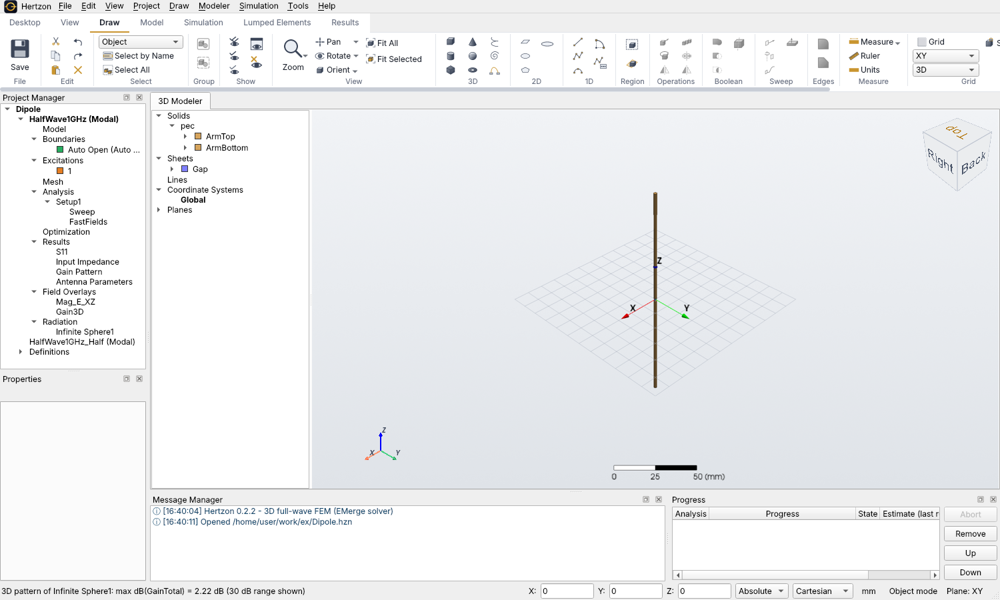
*The Hertzon window with the dipole of section 3: ribbon on top, Project Manager and Properties on the left, 3D Modeler tree and 3D view in the middle, messages and progress at the bottom.*

**The window.** On the left, the **Project Manager** shows the project tree (designs, Boundaries,
Excitations, Analysis, Results, Field Overlays, Radiation). Below it is the **Properties** panel of whatever
is selected. In the middle, the **3D Modeler** tree lists the objects (solids by material, sheets, lines)
next to the 3D view. At the bottom are the **Message Manager** and the **Progress** of running analyses.

**Selecting.** Press **O** to select whole objects and **F** to select single faces (E for edges, V for
vertices). Click to select, Ctrl+click to add. **Edit > Select by Name** finds an object in a large model.

**Navigating.**

| | Mouse | Alternatives |
|---|---|---|
| Rotate | Middle button drag | Alt + left drag |
| Pan | Shift + left drag | Ctrl + middle drag |
| Zoom | Mouse wheel (at the cursor) | Right drag, Shift + middle drag, Alt + Shift + left drag |

A plain left drag does not move the view. Without a middle button (touchpad), the
**Rotate** and **Pan** buttons on the Draw tab turn the left mouse button into rotate or pan mode
until you press Esc or click the button again. **View > Fit All** (or the ribbon button) brings
everything into view.

**Drawing with exact values.** You can draw by clicking on the grid, or type a coordinate into the
X/Y/Z fields of the status bar and press Enter. For the tutorials it is easiest to draw roughly and then
type the exact values: in the **3D Modeler** tree next to the view, expand the object and click its
creation entry (for example *CreateBox*), then edit Position, sizes and so on in the **Properties** panel.
Clicking the object itself shows its name, material and display attributes. **Draw > Create Primitive by
Dialog...** asks for all values at once instead.

**Variables.** Every number accepts expressions with units, such as `a/2`, `lambda0/4` or `2.5mm+t`. Define
variables in **Project > Design Properties...** and change them later: the model, ports and integration
lines follow.

**Solving.** **Simulation > Validation Check** lists problems before you start. **Simulation > Analyze All**
(F5) solves every enabled setup. Each adaptive pass appears in the Progress window, and **Results >
Solution Data...** shows the convergence table, the mesh statistics and the matrix data.

> The very first analysis after installing or updating compiles EMerge's solver kernels and takes a few
> minutes longer. The installer already does this once, so normally you do not notice it.

---

## 1. Waveguide with wave ports

**Goal:** S11 and S21 of a WR-90 rectangular waveguide (22.86 × 10.16 mm) with a metal post in the
middle, from 8 to 12 GHz. The finished project is `examples/WaveguidePost.hzn`.

### 1.1 New design and variables

1. **File > New**. The project starts with one empty design.
2. **Simulation > Solution Type...**: choose **Modal** and leave **Auto open region** at **Off**.
   A waveguide is a closed problem: every outer face that is not a port is a perfect conductor.
3. **Project > Design Properties...**: add the variables

   | Name | Value |
   |---|---|
   | `a` | `22.86mm` |
   | `b` | `10.16mm` |
   | `L` | `50mm` |
   | `r_post` | `1.5mm` |

### 1.2 Geometry

1. **Draw > Box**, then set in Properties: Position `0,0,0`, XSize `a`, YSize `L`, ZSize `b`. Rename the
   object to `Waveguide` (Name field). Material stays **vacuum**: the box is the air inside the guide.
2. **Draw > Cylinder**: CenterPosition `a/2,L/2,0`, Radius `r_post`, Height `b`, Axis `Z`. Name it
   `Post` and set **Material** to **pec**.
3. Select `Waveguide` first, then Ctrl+click `Post`, and choose **Modeler > Boolean > Subtract**. The post
   is cut out of the air box. Its surface becomes a perfect conductor automatically, like the outer walls.

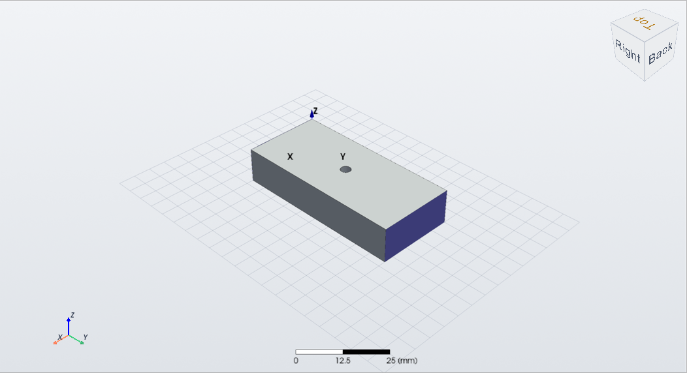
*The air box of the waveguide with the post cut out of it. The two end faces (blue) carry the wave ports.*

### 1.3 Wave ports

A wave port sits on an outer face of the model. Hertzon computes its modes (here the TE10 mode of the guide)
with a 2D eigenmode solve and feeds the 3D problem with it.

1. Press **F** (face selection) and click the end face of the box at y = 0.
2. **Simulation > Excitations > Assign > Wave Port** (or the large **Wave Port** button on the
   Simulation tab). Keep **Number of modes 1** and **Mode type Auto**, then press OK. It becomes port 1.
3. Select the face at y = L and assign a second **Wave Port**. It becomes port 2.

> Instead of a face of the box you can also draw a rectangle exactly on the end face (**Draw >
> Rectangle**, Axis `Y`) and assign the port to that sheet. The example file does this.

### 1.4 Solution setup and sweep

1. **Simulation > Analysis Setup > Add Solution Setup...**:
   * Solution frequency **Single**, Frequency `10GHz`, a frequency in the upper part of the band,
     where the mesh needs to be finest.
   * Maximum number of passes `6`, Maximum Delta S `0.02`.
2. Select `Setup1` in the tree, then **Simulation > Analysis Setup > Add Frequency Sweep...**:
   Sweep type **Interpolating**, Distribution **Linear Count**, Start `8GHz`, Stop `12GHz`, Count `201`.
   An interpolating sweep solves only as many frequencies as it needs and fits the rest.

### 1.5 Solve and look at the results

1. **Simulation > Validation Check**, then **Simulation > Analyze All** (F5).
2. Watch the passes in the Progress window. The analysis stops as soon as S changes by less than 0.02
   between two passes.
3. **Results > Create Report > Create Modal Solution Data Report > Rectangular Plot**: choose
   `dB(S(1,1))` and `dB(S(2,1))` over frequency. **Smith Chart** shows S11 on the Smith chart.
4. **Results > Mag E** with the waveguide selected (or a cut plane) shows the field. **Animate** runs
   the phase so you can see the wave travel and the post reflect it.
5. **File > Export Touchstone...** writes `WR90_Post.s2p` for other tools.

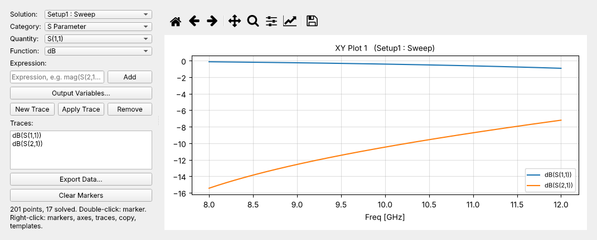
*S11 and S21 from 8 to 12 GHz. The thin post acts as a shunt inductance and reflects most of the power, less at higher frequencies.*

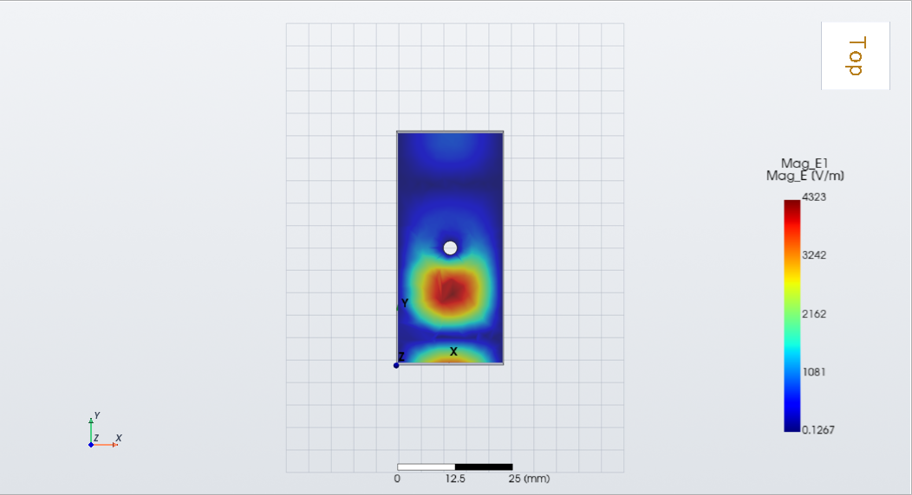
*Mag E on the plane halfway up the guide (z = b/2) at 10 GHz, seen from the top. The wave comes from port 1 at the bottom, forms a standing wave in front of the post and leaks past it.*

---

## 2. Coaxial cable with wave ports

**Goal:** a 20 mm long 50 Ω coax line with PTFE filling, from 1 to 10 GHz. It should be nearly perfectly
matched: |S11| far below −30 dB and |S21| ≈ 0 dB, with the phase of S21 falling linearly with
frequency. The finished project is `examples/Coax.hzn`.

For a coax with inner radius *a*, outer radius *b* and permittivity εr:
Z0 = 60 Ω / √εr · ln(b/a). With εr = 2.1 (Teflon) and *a* = 0.5 mm, 50 Ω needs *b* = 1.675 mm.

### 2.1 Design and variables

1. **Project > Insert Design** (or **File > New**), **Solution Type**: **Modal**, Auto open **Off**.
2. **Design Properties**: `a = 0.5mm`, `b = 1.675mm`, `L = 20mm`.

### 2.2 Geometry

1. **Draw > Cylinder**: CenterPosition `0,0,0`, Radius `b`, Height `L`, Axis `Z`. Name `Dielectric`,
   material **Teflon (tm)**. Its outer surface is the outer conductor: an outer face without a
   boundary is a perfect conductor.
2. **Draw > Cylinder**: CenterPosition `0,0,0`, Radius `a`, Height `L`, Axis `Z`. Name `Inner`,
   material **pec**.
3. Select `Dielectric`, Ctrl+click `Inner`, **Modeler > Boolean > Subtract**. The dialog shows
   `Dielectric` under *Blank Parts* and `Inner` under *Tool Parts*. Tick **Clone tool objects before
   operation** if you want to keep the inner conductor as a visible PEC object. Without it, the hole's
   surface is a perfect conductor anyway, which gives the same result.

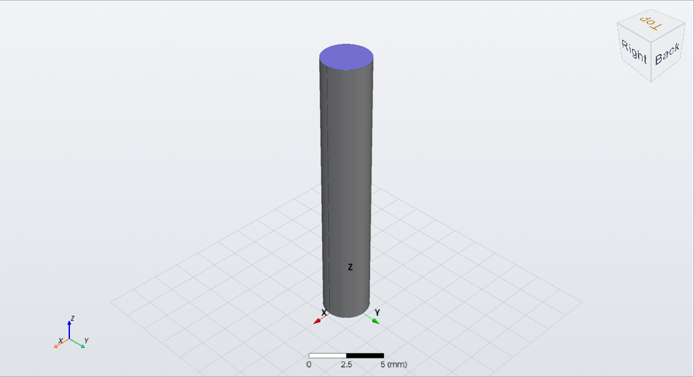
*The PTFE cylinder with the PEC inner conductor. The end face (blue) is one of the circular port sheets.*

### 2.3 Wave ports on the annular end faces

1. **Draw > Circle**: CenterPosition `0,0,0`, Radius `b`, Axis `Z`. Name `Port1`.
2. **Draw > Circle**: CenterPosition `0,0,L`, Radius `b`, Axis `Z`. Name `Port2`.
3. Select `Port1` (press **O**), **Simulation > Excitations > Assign > Wave Port**, OK. Do the same for
   `Port2`.

   The port solver finds the TEM mode of the ring between inner and outer conductor by itself. Mode type
   **Auto** is right here. **TEM** would force it.
4. Optional: in the port's **Post Processing** tab, **Renormalize** to `50ohm` and **Deembed** a
   distance if you want the reference plane elsewhere.

### 2.4 Setup, sweep and results

1. **Add Solution Setup...**: Frequency `5GHz`, Maximum passes `6`, Maximum Delta S `0.02`.
2. **Add Frequency Sweep...**: **Interpolating**, Linear Count, `1GHz` to `10GHz`, Count `37`.
3. **Analyze All**.
4. Plot `dB(S(1,1))`, `dB(S(2,1))` and `ang_deg(S(2,1))`. A deep S11 over the whole band shows that the
   line is matched to the port, which means its impedance is the 50 Ω you designed.

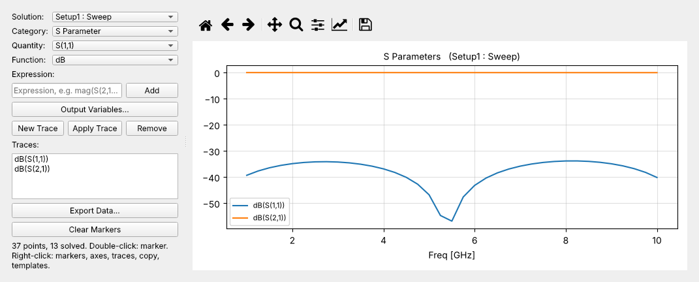
*S11 stays below −35 dB from 1 to 10 GHz, S21 is at 0 dB.*

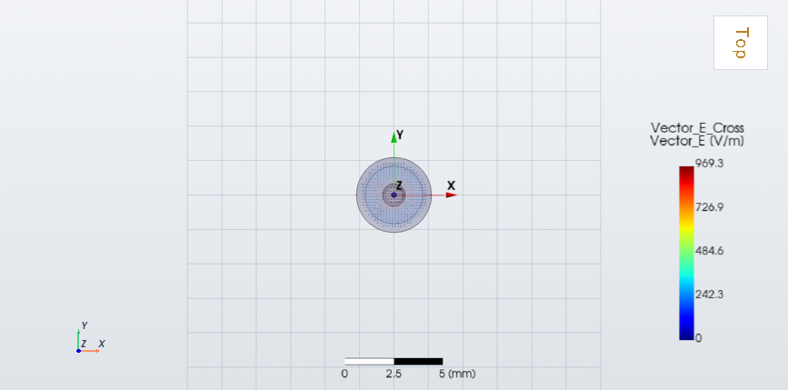
***Vector E** on the cross-section halfway along the line (plane XY at z = L/2): the radial TEM field between inner and outer conductor, strongest at the inner conductor.*

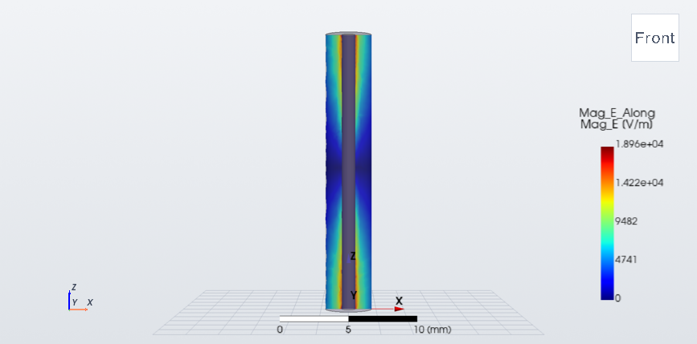
***Mag E** on the plane XZ through the axis: a travelling wave without standing-wave pattern, because the line is matched.*

> **What you should get** (this model solved with Hertzon 0.1.15: 2 adaptive passes, 8 939 tetrahedra,
> about half a minute): S11 stays below −35 dB from 1 to 10 GHz, and S21 is better than −0.03 dB.
> The phase of S21 falls by 34.9° per GHz. The theoretical value for 20 mm of PTFE line is
> 360° · √2.1 · 20 mm / c0 = 34.8° per GHz.

---

## 3. Half-wave dipole

**Goal:** a dipole for 1 GHz, made of two PEC rods with a small feed gap, fed by a lumped port.
Results are the input impedance (about 73 Ω at resonance), S11, the radiation pattern and the gain
(about 2.15 dBi). The finished project is `examples/Dipole.hzn`.

### 3.1 Design with an open region

1. **Insert Design**, then **Simulation > Solution Type...**: **Modal**, **Auto open region: Auto Open**,
   **Open boundary: Auto**.

   Auto Open puts an air box around the model and an absorbing boundary on its surface, at least a
   third of a wavelength away. You do not draw an air box yourself. Choose **PML** instead of Auto if
   the outer boundary must be very close to the model.
2. **Design Properties**: `Larm = 70mm` (one arm, about λ/4 a little shortened), `r = 1mm` (rod radius),
   `g = 2mm` (feed gap).

### 3.2 Geometry

1. **Draw > Cylinder**: CenterPosition `0,0,g/2`, Radius `r`, Height `Larm`, Axis `Z`. Name `ArmTop`,
   material **pec**.
2. **Draw > Cylinder**: CenterPosition `0,0,-g/2`, Radius `r`, Height `-Larm`, Axis `Z`. Name
   `ArmBottom`, material **pec**. A negative height draws downwards.
3. **Draw > Rectangle**: Position `-r,0,-g/2`, Axis `Y`, XSize `2*r`, ZSize `g`. Name `Gap`. This
   sheet fills the gap between the two rod ends and becomes the port.

### 3.3 Lumped port

1. Select `Gap` (**O**), **Simulation > Excitations > Assign > Lumped Port** (or the **Lumped Port**
   ribbon button).
2. **Full port impedance**: `73ohm` (or `50ohm`, if you want S11 against a 50 Ω generator).
3. **Integration line**: Hertzon proposes a line across the shorter side of the sheet. The gap sheet here is
   square, so check it. It must run from one arm to the other, along Z: `0,0,-g/2;0,0,g/2`.
   The line is drawn as an arrow on the model.

### 3.4 Far field, setup and sweep

1. **Simulation > Radiation > Insert Far Field Setup > Infinite Sphere...** (ribbon: **Far Field**):
   θ 0..180° and φ 0..360°. Set both steps from the default 10° to `2deg` for smooth pattern plots.
   This tells Hertzon where to evaluate the radiation.
2. **Add Solution Setup...**: Frequency `1GHz`, Maximum passes `10`, Maximum Delta S `0.02`.
3. **Add Frequency Sweep...**: **Interpolating**, Linear Count, `0.7GHz` to `1.3GHz`, Count `121`.
4. **Validation Check**, **Analyze All**.

### 3.5 Results

1. **Results > Create Report > Create Modal Solution Data Report > Rectangular Plot**:
   `dB(S(1,1))` shows the resonance. Choose the category **Z Parameter** for `re(Z(1,1))` and
   `im(Z(1,1))`, the input impedance. Resonance is where the imaginary part crosses zero.
2. **Create Far Fields Report > Radiation Pattern**: `dB(GainTotal)` over θ at φ = 0° is the
   familiar figure eight. **3D Polar Plot** shows the doughnut.
3. **Results > Overlay 3D Pattern on Model** puts the 3D pattern onto the dipole.
4. **Create Antenna Parameters Report > Data Table**: peak gain, directivity, radiated power and
   radiation efficiency.
5. **Results > Mag E** on a cut plane through the dipole, then **Animate**: you can watch the waves
   leave the antenna.

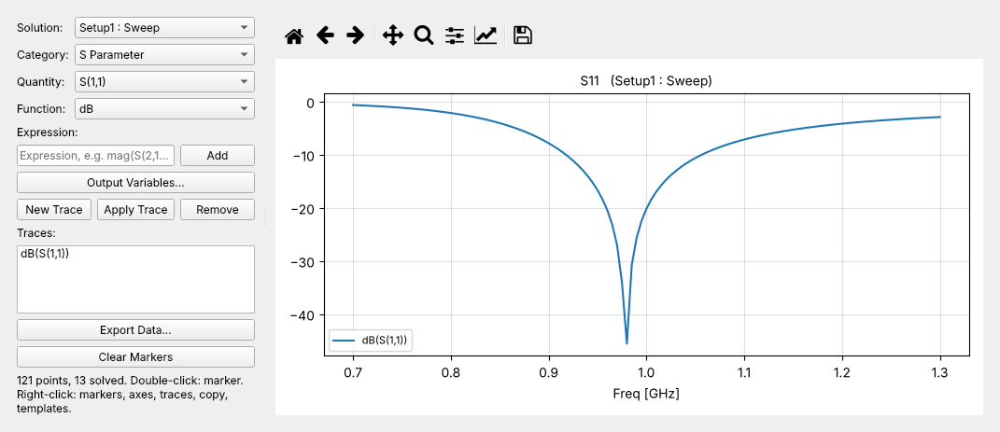
*S11 against the 73 Ω port: resonance at 0.98 GHz with −41 dB.*

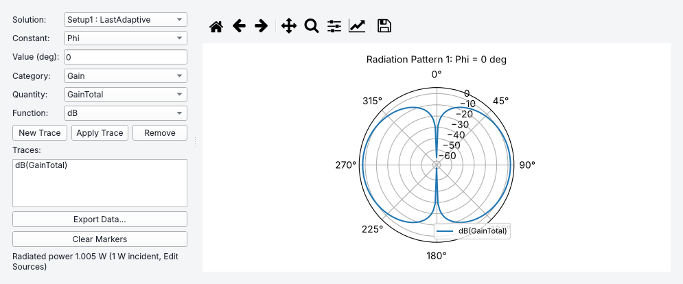
***Radiation Pattern**, dB(GainTotal) over θ at φ = 0°: the figure eight with 2.2 dBi at θ = 90° and deep nulls along the dipole axis.*

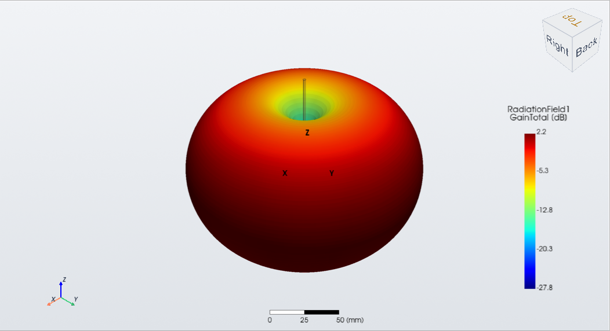
***Overlay 3D Pattern on Model**: the doughnut-shaped gain pattern around the dipole.*

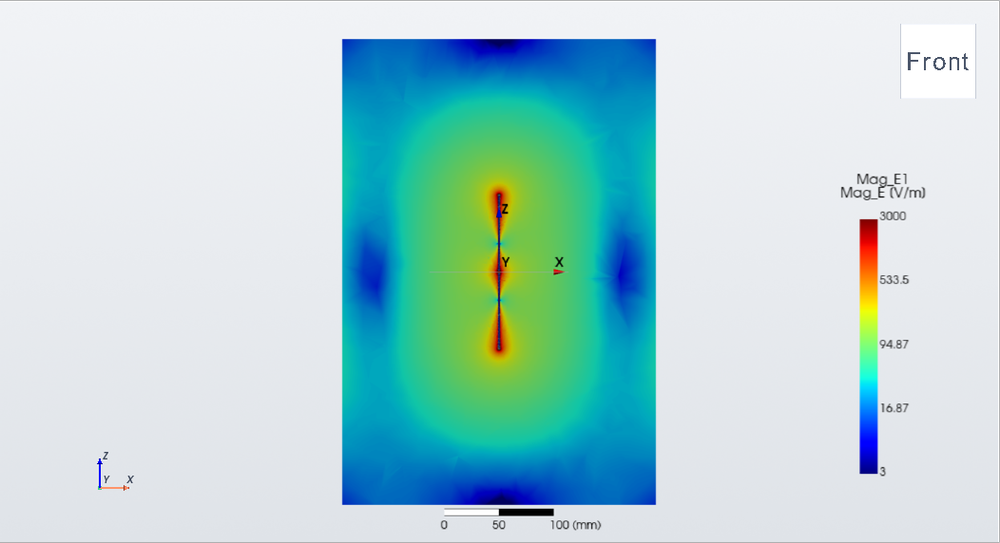
***Mag E** on the XZ plane with a logarithmic scale (Field plot **Attributes**: Log, limits 3 to 3000 V/m). The field is strongest at the rod ends and in the feed gap and falls off with distance, slowest broadside.*

> **What you should get** (this model solved with Hertzon 0.1.15: 3 adaptive passes, 42 152 tetrahedra,
> about four minutes): the input impedance is 71.7 Ω, almost purely real, at 0.975 GHz. Against the
> 73 Ω port the deepest S11 is −41 dB at 0.98 GHz. The peak gain is 1.66, that is 2.21 dBi, at θ = 90°.
> A thin half-wave dipole has 73 Ω and 2.15 dBi in theory.

Change `Larm` and **Analyze All** again to move the resonance. Or let **Simulation > Optimization > Add
Optimization...** find the length for S11 < −20 dB at 1 GHz.

---

## 4. Radar cross section of a sphere

**Goal:** the monostatic and bistatic RCS of a perfectly conducting sphere of radius 100 mm at 1 GHz,
lit by a plane wave. For a sphere the exact answer is known (Mie series), so this is the classic way
to check an RCS setup. The finished project is `examples/SphereRCS.hzn`, and the 250 mm sphere in
`examples/NATO-Sphere.hzn` is set up the same way.

### 4.1 Design

1. **Insert Design**, **Solution Type**: **Modal**, **Auto Open**, **Open boundary: PML**.
   PML absorbs the scattered wave better than a first-order radiation boundary at all angles, which
   matters for low RCS values.
2. **Design Properties**: `R = 100mm`.

### 4.2 Geometry

1. **Draw > Sphere**: CenterPosition `0,0,0`, Radius `R`. Name `Sphere`, material **pec**.

That is the whole model: the air region and the PML come from Auto Open.

### 4.3 Incident plane wave

1. With nothing selected, **Simulation > Excitations > Assign > Incident Plane Wave**.
2. **Vector input format: Cartesian**, **k direction** `0,0,1` (the wave travels in +z), **Eo vector**
   `1,0,0` (x polarization), **E0** `1` V/m, zero phase at `0,0,0`.

   With **Spherical** you give the direction of incidence as θ, φ and a polarization angle instead.

### 4.4 Far field and setup

1. **Insert Far Field Setup > Infinite Sphere...**: θ 0..180°, φ 0..360°, both steps `2deg`. RCS is computed
   on this sphere.
2. **Add Solution Setup...**:
   * Frequency `1GHz`, Maximum passes `8`.
   * With only an incident wave there are no S-parameters. Convergence uses **Maximum Delta Energy**
     instead, the relative change of the scattered energy between passes. Use `0.001`.
   * **Options** tab: **Order of basis functions: Second Order** and **Curved elements** on (default).
     Curved second-order elements follow the sphere surface exactly and give accurate RCS with
     few elements.
3. **Analyze All**.

### 4.5 Results

1. **Create Far Fields Report > Radiation Pattern** with **Bistatic RCS**: `dB(BistaticRCSTotal)` in
   dBsm over θ at φ = 0° (the E-plane) and φ = 90° (the H-plane). θ = 180° is the backscatter
   direction, θ = 0° the forward scatter.
2. **Create Monostatic RCS Report > Data Table** gives the backscatter RCS in m² and dBsm.
   **Rectangular Plot** draws it over the adaptive passes, so you see it converge.
3. **Results > Mag E** on a cut plane (for example the XZ plane) shows the shadow behind the sphere and the
   standing wave in front of it. In **Simulation > Excitations > Edit Sources...** choose whether the plot
   shows the **Total**, the **Scattered** or the **Incident** field.

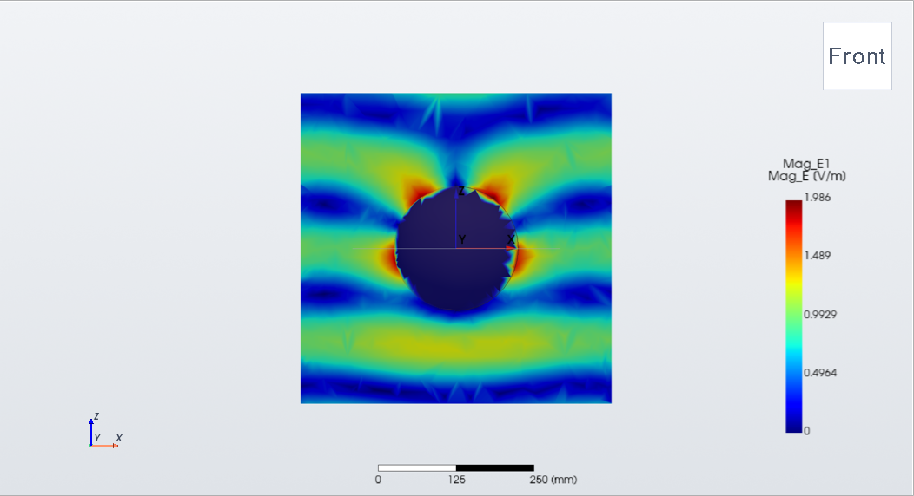
*Total **Mag E** on the XZ plane. The wave comes from below (k = +z, E along x): a standing wave in front of the sphere, the shadow behind it.*

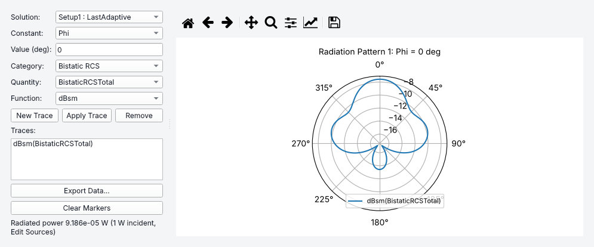
*Bistatic RCS in dBsm over θ at φ = 0°. The forward scatter at θ = 0° is strongest. θ = 180° is the backscatter, the monostatic RCS.*

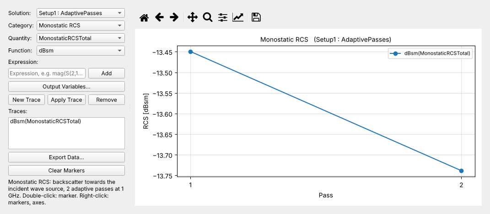
***Monostatic RCS** over the adaptive passes: it settles at −13.43 dBsm. The Mie series gives −13.48 dBsm.*

> **What you should get** (this model solved with Hertzon 0.1.15: 6 adaptive passes, 7 728 curved
> second-order tetrahedra, about half a minute): a monostatic RCS of 0.0455 m² (−13.43 dBsm). The Mie
> series gives 0.0448 m² (−13.48 dBsm), so the difference is 1.3 % or 0.05 dB.
> `examples/benchmark/sphere_rcs/mie_pec.py` computes the Mie value for any radius and frequency.

For your own RCS models, import the geometry with **Modeler > Import...** (STEP, IGES, BREP or STL)
and set the material to pec. `examples/DroneRCS.hzn` does that with a drone from an STL file.

---

## 5. Let an AI assistant build and run it (MCP)

Hertzon includes an MCP server, a standard interface through which AI assistants use programs. With it,
Claude Code, the Claude desktop app, Codex or VS Code (Copilot agent mode) can build every model of this
tutorial for you, run it and read the results. They can also explain them and change the design until a
goal is met.

### 5.1 Set it up once

1. **Tools > AI Assistants (MCP)...**
2. Press **Register** next to your assistant:

   | Assistant | Where Hertzon is registered |
   |---|---|
   | Claude Code | `~/.claude.json` |
   | Claude desktop app | `claude_desktop_config.json` |
   | Codex | `~/.codex/config.toml` |
   | VS Code | the user `mcp.json` |

   Without the GUI: `python -m hertzon.mcp --install claude` (or `desktop`, `codex`, `vscode`, `all`).
   `python -m hertzon.mcp --config` prints the settings for any other MCP client.
3. Tick **Let AI assistants work in this window**. Everything the assistant does then happens in your
   open window: you see objects appear, **Ctrl+Z** undoes them, and its analyses run in the normal
   solve queue with the normal progress display. Without the live link the assistant works on `.hzn`
   files and solves in the background.
4. Start a new session of your assistant so it loads the Hertzon server.

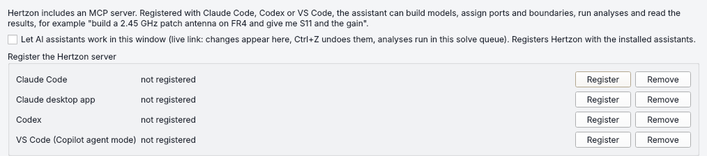
***Tools > AI Assistants (MCP)...**: the live link checkbox and one Register button per assistant.*

### 5.2 Ask for a simulation

Write what you want in plain language. Some examples matching this tutorial:

* *"Create a WR-90 waveguide, 50 mm long, with a PEC post of radius 1.5 mm in the middle, wave ports on
  both ends, and sweep 8-12 GHz. Plot S11 and S21."*
* *"Build a 50 Ω PTFE coax, 20 mm long, with wave ports, and check that S11 is below −30 dB from 1 to
  10 GHz."*
* *"Draw a half-wave dipole for 1 GHz with a lumped port, solve it and give me the input impedance at
  resonance and the peak gain. Then shorten it until S11 at 1 GHz is below −20 dB."*
* *"Compute the monostatic RCS of a 100 mm PEC sphere at 1 GHz and compare it with the Mie series."*
* *"Open examples/PatchAntenna.hzn, explain what the model does, and render a picture of it."*

The assistant works step by step with the same building blocks you used above, and tells you what it did.

### 5.3 What the assistant can do

| Area | Tools |
|---|---|
| Projects | `create_project`, `open_project`, `get_project`, `save_project`, `get_context` |
| Settings and materials | `set_design` (units, variables, solution type, Auto Open), `list_materials`, `add_material`, `get_schema` |
| Geometry | `add_object`, `import_geometry`, `modify_object`, `add_operation` (subtract, unite, ...), `delete`, `get_geometry` (faces with index, centre, normal) |
| Boundaries and ports | `assign`, `modify_assignment` (boundaries, wave/lumped ports, plane waves, mesh operations) |
| Analysis | `set_setup`, `set_sweep`, `set_far_field_sphere`, `validate`, `run_simulation`, `get_status`, `abort_simulation` |
| Results | `get_results` (S-parameters, impedances, gain, RCS, convergence), `render_image` (a picture of the model) |
| Scripting | `run_python` for anything else, with the Hertzon model API |

Simulation results can be wrong, whether you or an assistant set the model up. Check them as described in
the README's *No warranty* section.

---

## Where to go next

* `examples/` has twelve finished projects, from a microstrip line to a Rotman lens. See the table in the
  [README](../README.md#examples).
* **Tools > Antenna Design > Rectangular Patch...** and **Tools > Filter Design > Tapped Hairpin...** create
  complete, parametrized designs with setup, sweep and optimization from a few specifications.
* [MESHER.md](MESHER.md) explains how adaptive meshing works. [FEATURE_MATRIX.md](FEATURE_MATRIX.md)
  shows what is implemented.
* **File > Export EMerge Python Script** turns any design into a stand-alone EMerge script.
